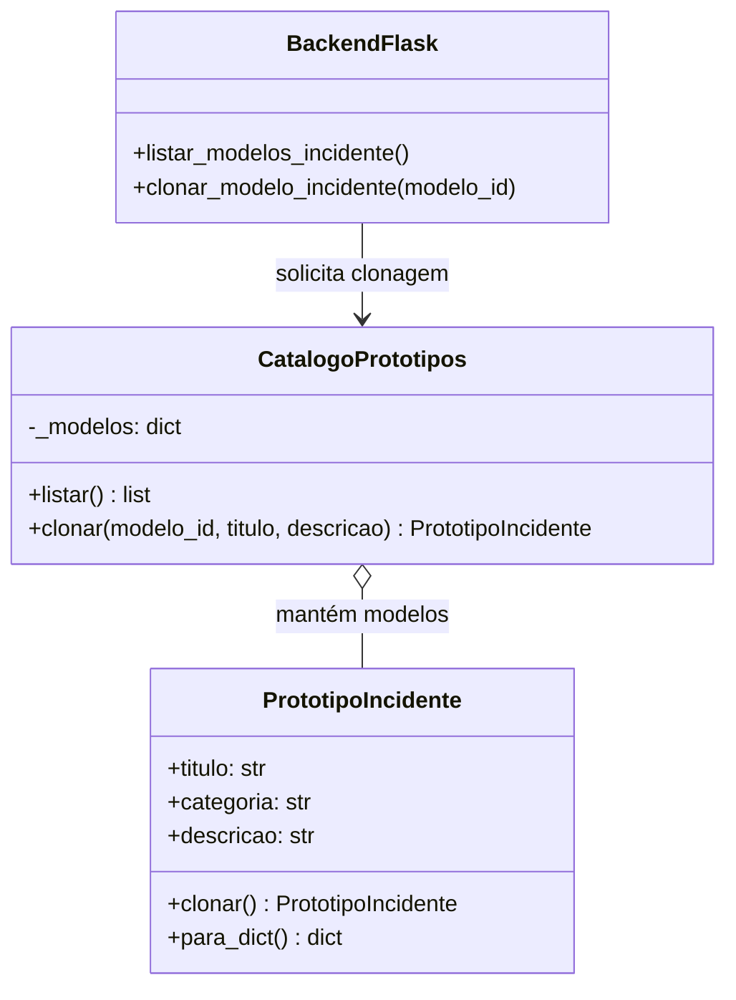

# Padrão de Projeto Prototype no CyberFlow

## Objetivo

Aplicar o padrão criacional Prototype para permitir que analistas criem incidentes a partir de modelos já configurados. Em vez de preencher todos os campos repetidamente, o sistema clona um protótipo e permite personalizar o título e a descrição da cópia.

## Problema

Incidentes recorrentes, como phishing, ransomware e malware, costumam compartilhar categoria e orientações iniciais. Criar cada registro do zero gera repetição e aumenta a chance de descrições inconsistentes.

## Solução

O módulo `patterns/prototype.py` mantém um catálogo de objetos `PrototipoIncidente`. Cada protótipo implementa `clonar()` usando `deepcopy`, criando um novo objeto independente. `CatalogoPrototipos` localiza o modelo, clona-o e aplica as personalizações apenas à cópia. O backend persiste o incidente clonado no banco já utilizado pelo CyberFlow.

## Modelos disponíveis

- `phishing`
- `ransomware`
- `malware`
- `ddos`
- `vazamento-dados`
- `acesso-indevido`

## Exemplo de uso

Listar os protótipos:

```http
GET /modelos-incidente
```

Clonar um protótipo e personalizar o título:

```http
POST /incidentes/modelos/phishing/clonar
Content-Type: application/json

{
  "titulo": "E-mail suspeito recebido pelo Financeiro"
}
```

A API cria um novo incidente com a categoria e a descrição-base do protótipo, usa a data/hora atual quando não informada e inicia o registro com status `Aberto`. Também é possível enviar `descricao` para substituir a descrição-base.

## Diagrama UML



## Comparação dos quatro padrões criacionais

| Padrão | Problema que resolve | Ideia central |
|---|---|---|
| Singleton | Evitar múltiplas instâncias de um recurso que deve ser único | Restringe a classe a uma única instância compartilhada |
| Factory Method | Evitar que o código cliente dependa diretamente das classes concretas que cria | Delega a criação do objeto a um método especializado |
| Builder | Organizar a criação de objetos complexos com várias etapas ou configurações | Monta o objeto passo a passo |
| Prototype | Evitar reconstruir objetos semelhantes repetidamente | Cria novos objetos clonando protótipos existentes |

## Conclusão

Os quatro padrões resolvem desafios diferentes da criação de objetos. No CyberFlow, Prototype é adequado aos modelos reutilizáveis de incidentes: o analista parte de uma configuração pronta, personaliza a cópia e mantém o protótipo original intacto. Isso reduz repetição e padroniza os registros sem alterar o fluxo de persistência já existente.

## Testes

Os testes específicos desta implementação ficam em `tests/test_prototype.py`. Execute toda a suíte com:

```bash
python -m pytest -q
```
